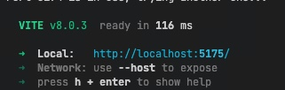
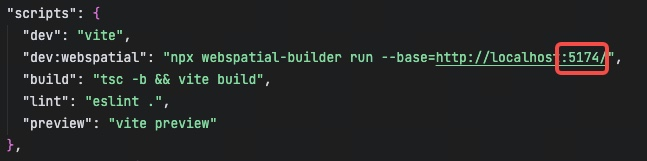
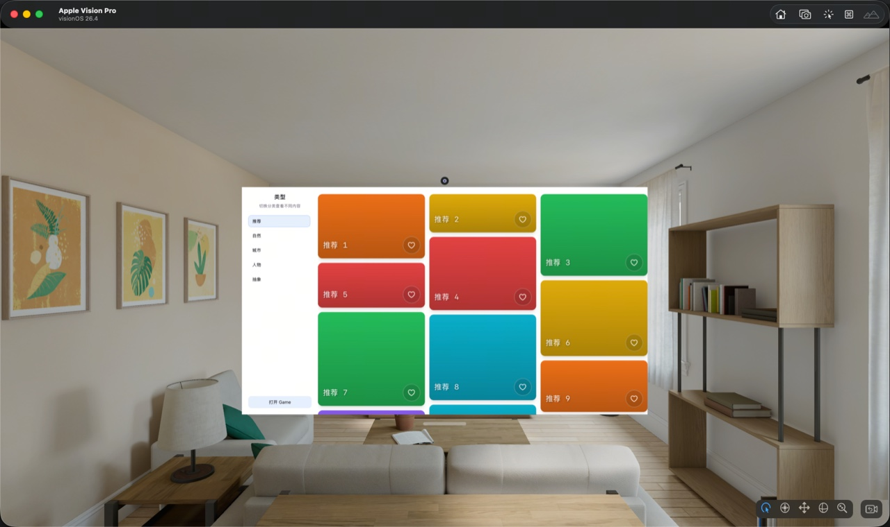
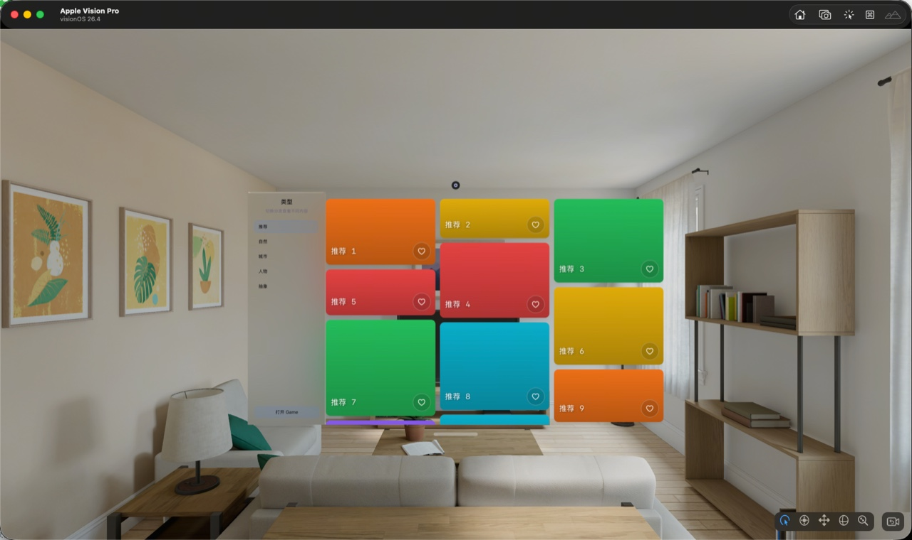
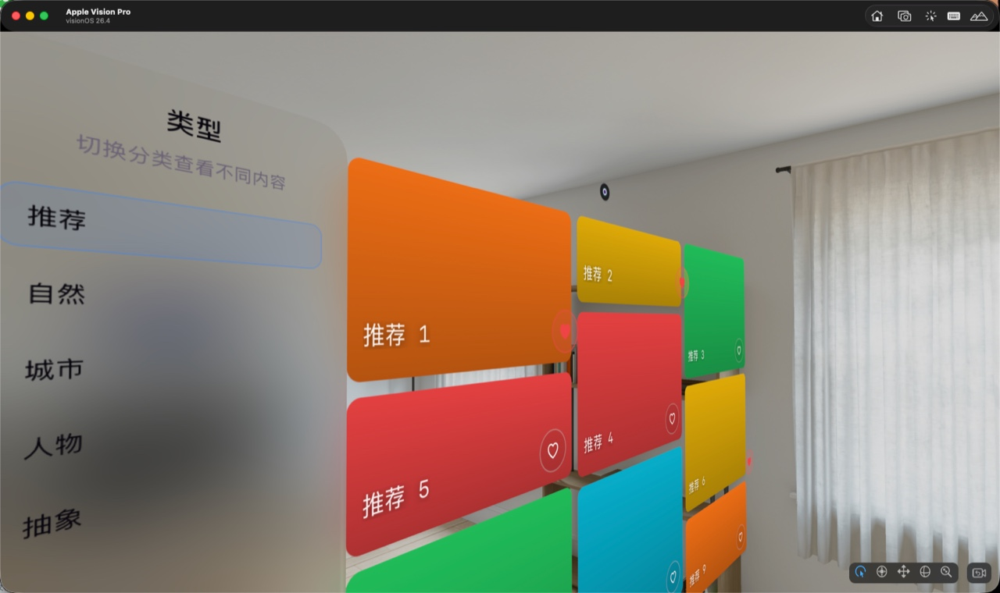
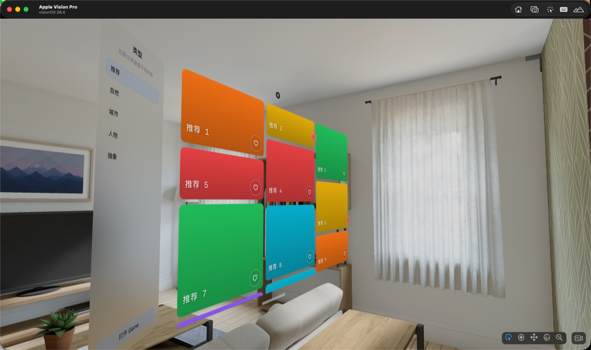
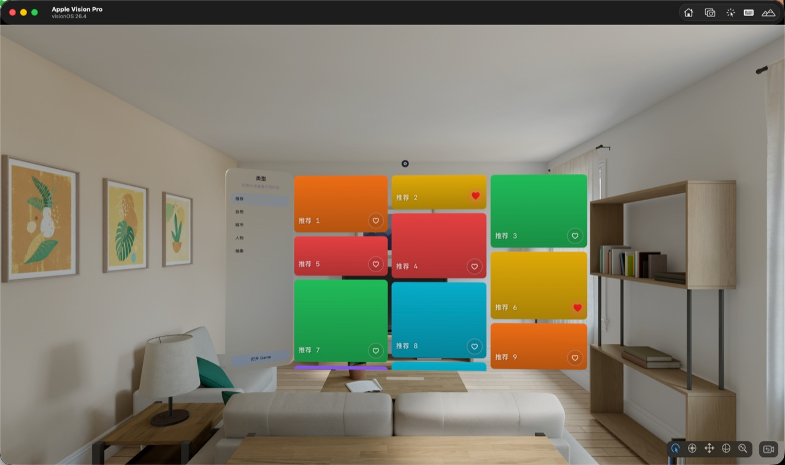
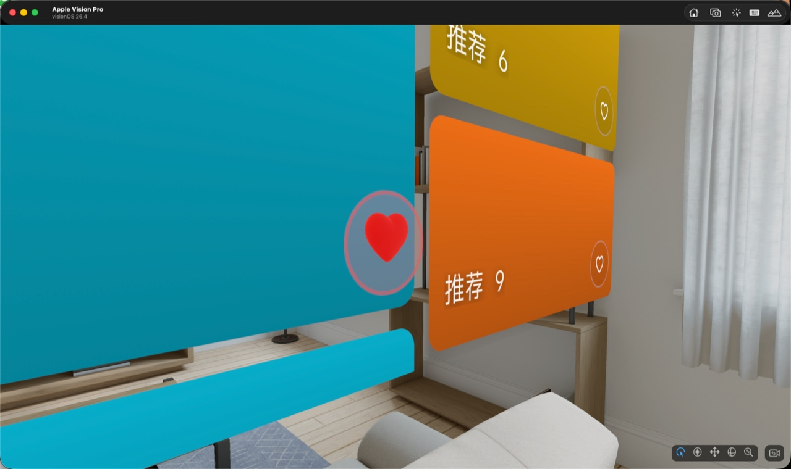
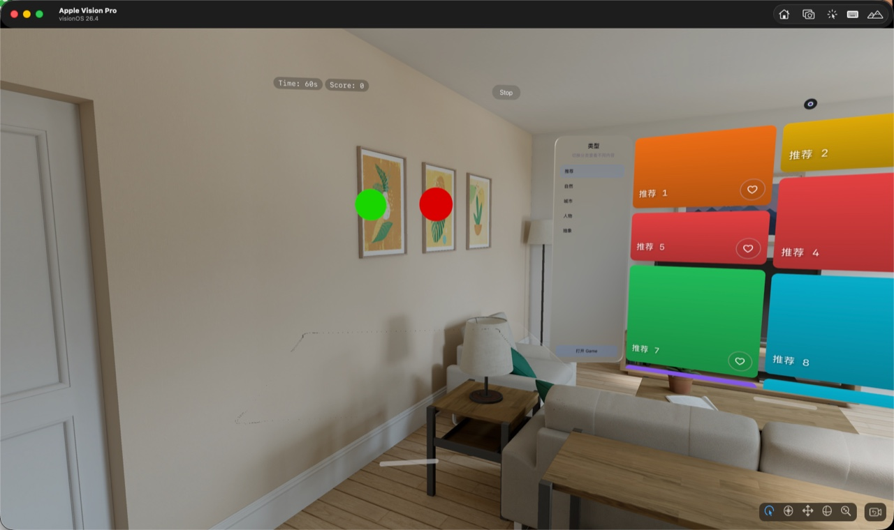

# 快速示例：从传统前端到空间应用的演进

本文档旨在通过一个最精简的示例，帮助你快速感受 WebSpatial SDK 的实际效果与开发体验。我们将从一个标准的 React + Vite 前端项目出发，逐步为其添加空间化特性，最终演进为一个支持 Apple Vision Pro 等空间设备的完整应用。

> **💡 提示**
>
> 你可以跟着本文档从头开始构建 Demo，或者直接从仓库中拉取现成的完成版进行体验。

***

## 1. 准备工作

### 1.1 拉取示例代码

首先，将包含基础代码的示例仓库拉取到本地：

```bash
git clone git@github.com:webspatial/webspatial-playground-sample.git
```

### 1.2 安装相关依赖

工程中已集成 WebSpatial 相关 npm 包。因此在拉取完代码后，仅需执行依赖安装命令，等待依赖安装完毕即可。

主要的 WebSpatial 依赖如下：

```json
"dependencies": {
    ...
    "@webspatial/core-sdk": "^1.4.0",
    "@webspatial/react-sdk": "^1.4.0"
},
"devDependencies": {
    ...
    "@webspatial/builder": "^1.4.0",
    "@webspatial/platform-visionos": "^1.4.0",
    ...
}
```

### 1.3 检查配置

为了让 React 能够识别并编译我们提供的特殊属性（如 `enable-xr`），我们需要检查 `tsconfig.app.json` 中是否配置了 `jsxImportSource` 为 `@webspatial/react-sdk`。

```json
{
  "compilerOptions": {
    ...
    "jsx": "react-jsx",
    "jsxImportSource": "@webspatial/react-sdk",

    /* Linting */
    ...
  },
  "include": ["src"]
}
```

### 1.4 验证与运行

首先启动基础 Web 页面：

1. 执行 `pnpm run dev` 命令，观察本地服务器被正常唤起。
   |  |  |
   | :-----------------------------------------: | :-----------------------------------------: |
2. 页面可正常展示后，记录本地服务器的端口号，将其替换至 `package.json` 中 `dev:webspatial` 命令对应的端口号（如：`--base=http://localhost:5174/`）。

然后编译并运行webspatial应用：

1. 执行 `pnpm run dev:webspatial` 命令。
2. 若此前已安装 Xcode 及 visionOS 模拟器，该命令将自动唤起 visionOS 模拟器。

   

> **🎉 恭喜！** 现在你已经通过 `webspatial-sdk` 成功打包出一个传统前端项目了。接下来，我们将逐步解锁 WebSpatial SDK 为你带来的空间特性。

***

## 2. 空间化元素

在开始具体的空间化改造前，我们需要先补上一层“环境判断”。因为很多空间特性只应该在 WebSpatial 运行环境下启用，而在普通浏览器中仍然需要保留原有的 2D 展示和交互逻辑。

这里我们通过一个全局标记 `appInfo.isWebSpatial` 来判断当前是否运行在 WebSpatial 环境中。它定义在 `src/utils/utils.ts` 中，初始值为 `false`：

> **新增逻辑** 在 `src/utils/utils.ts` 末尾新增一个全局环境标记，供页面和组件复用。

```diff
 export const appInfo = {
   isWebSpatial: false
 }
```

随后，在页面入口中根据 `userAgent` 更新这个标记。例如主页面 `src/pages/main/App.tsx` 和小游戏页面 `src/pages/game/game.tsx` 都会在运行时执行下面这句逻辑：

> **修改位置** `src/pages/main/App.tsx` 与 `src/pages/game/game.tsx` 的函数内部，在初始化渲染逻辑前补上环境判断。

```diff
+ appInfo.isWebSpatial = window.navigator.userAgent.includes('WebSpatial')
```

后面像 `transform`、`Model`、`Reality` 以及空间小游戏等特性，都会基于这个标记来决定是走 WebSpatial 的空间化能力，还是继续保留普通 Web 的兜底展示。

### 2.1 背景材质

对于空间应用，传统的纯色背景往往显得扁平，无法体现空间感。我们可以通过修改页面背景材质，对应用实现初步的空间化。

#### 2.1.1 透明材质

页面的全局背景色位于 `/src/pages/main/index.css`，这是 Vite 工程默认的配置。我们只需要去掉这一配置，让应用在空间设备中呈现透明背景。

> **修改位置** `src/pages/main/index.css` 的第 `18-23` 行，核心修改在第 `22` 行。

```diff
  :root {
    ...
    color: var(--text);
-   background: var(--bg);
+   /* background: var(--bg); */
    font-synthesis: none;
    ...
  }
```


#### 2.1.2 毛玻璃材质

对于导航，我们并不希望它的背景是透明的，因为它无法给予用户很好的视觉体验，我们希望提供更原生的体验，譬如毛玻璃背景。

要将导航背景材质改为毛玻璃，我们需要先将导航进行**空间化处理**（对页面元素添加 `enable-xr` 属性），然后再修改其背景材质（`"--xr-background-material": "translucent"`）。我们仅需修改 `/src/pages/main/component/Nav.tsx` 文件：

> **修改位置** `src/pages/main/component/Nav.tsx` 的第 `24` 行附近，将原本的 `<aside className="sidebar">` 扩展为带空间属性的写法。

```diff
-   <aside className="sidebar">
+   <aside
+     enable-xr
+     style={{
+       backgroundColor: 'transparent',
+       "--xr-background-material": "translucent",
+       borderRadius: "30px",
+     }}
+     className="sidebar"
+   >
      <div className="sidebarHeader">
        <h2 className="sidebarTitle">{title}</h2>
```



### 2.2 `--xr-back` (空间深度)

在空间应用中，元素的深度感（Z 轴上的层级关系）是提升立体感的重要手段。我们可以通过 `--xr-back` 属性将元素向外或向内推。

#### 2.2.1 组件空间化

为了让图片卡片（`ImageCard.tsx`）上的点赞按钮拥有独立的空间层级，我们首先需要在按钮外层包裹一个支持空间特性的容器，并为其添加 `enable-xr` 属性：

> **修改位置** `src/pages/main/component/ImageCard.tsx` 的第 `22-27` 行附近，先在点赞按钮外层增加一个带 `enable-xr` 的包裹容器。

```diff
-   <button
-     type="button"
-     className={`likeButton${liked ? ' isLiked' : ''}`}
-     ...
-   >
+   <div enable-xr>
+     <button
+       type="button"
+       className={`likeButton${liked ? ' isLiked' : ''}`}
+       ...
+     >
```

#### 2.2.2 空间深度位移

除了包裹空间特性容器，我们还需要给这个容器补上 `ref`，然后在用户点赞时通过设置 `--xr-back` 属性来实现元素的空间深度变化（例如在被点赞时从背景中突显出来）：

> **新增逻辑** 建议加在 `src/pages/main/component/ImageCard.tsx` 的第 `1` 行导入区、第 `11` 行后的变量定义区域、第 `17` 行后的副作用逻辑区域，以及点赞按钮外层容器处。

```diff
+ import { useEffect, useRef } from 'react'
 
  function ImageCard({ tile, liked, onToggleLike }: ImageCardProps) {
+   const xrBackElRef = useRef<HTMLDivElement | null>(null)
+
+   useEffect(() => {
+     // liked为true时，将其向外推20物理单位；否则重置为0
+     if (xrBackElRef.current) {
+       xrBackElRef.current.style.setProperty('--xr-back', String(liked ? 20 : 0))
+     }
+   }, [liked])

-       <div enable-xr>
+       <div ref={xrBackElRef} enable-xr>
```



#### 2.2.3 平滑位移动画

直接设置属性会使位移显得生硬，为了得到更出色的空间交互体验，我们可以在 `2.2.2` 的基础上，继续利用 `requestAnimationFrame` 动态平滑地插值修改 `--xr-back` 属性。

将刚才的直接修改替换为以下更平滑的动画插值代码：

> **增量修改** 在 `2.2.2` 的基础上，继续改动 `src/pages/main/component/ImageCard.tsx` 的第 `11` 行后的变量定义区，以及第 `17` 行后的副作用逻辑区域。

```diff
  function ImageCard({ tile, liked, onToggleLike }: ImageCardProps) {
+   const backRef = useRef(0)
+   const targetBack = useRef(0)
+
+   useEffect(() => {
+     targetBack.current = liked ? 20 : 0
+   }, [liked])
+
+   useEffect(() => {
+     let rafId = 0
+     const updateBack = () => {
+       backRef.current += (targetBack.current - backRef.current) * 0.3
+       xrBackElRef.current?.style.setProperty('--xr-back', String(backRef.current))
+       rafId = requestAnimationFrame(updateBack)
+     }
+     rafId = requestAnimationFrame(updateBack)
+     return () => cancelAnimationFrame(rafId)
+   }, [])
```

<video autoplay loop muted playsinline width="100%">
  <source src="./quick_example_asset/2.2.3.mp4" type="video/mp4" />
  你的浏览器不支持 video 标签。
</video>

### 2.3 空间旋转 (transform)

除了平移，我们还能通过标准的 CSS `transform` 为整个容器提供 3D 偏转角度。我们可以基于环境标识（是否为 WebSpatial）来对导航栏进行一定的 3D 旋转，使得整个应用不再是死板的 2D 界面，而是能够以 3D 方式展示。修改 `/src/pages/main/component/Nav.tsx`：

> **修改位置** `src/pages/main/component/Nav.tsx` 的导入区，以及第 `24` 行附近的 `aside` 样式对象。

```diff
+ import { appInfo } from '../../../utils/utils'
  
    <aside
      enable-xr
      style={{
        backgroundColor: 'transparent',
        "--xr-background-material": "translucent",
        borderRadius: "30px",
+       transform: appInfo.isWebSpatial ? "rotateY(30deg)" : undefined,
      }}
      className="sidebar"
    >
```

|  |  |
| :---------------------------------------: | :---------------------------------------: |

***

## 3. 空间模型（Model组件）

要在 Web 页面中渲染原生的高性能 3D 模型，我们可以使用 WebSpatial 提供的 `<Model>` 组件。

### 3.1 Model组件

在 `ImageCard.tsx` 中，当用户点赞时，我们不再仅仅显示简单的 2D 图标，而是渲染一个 3D 爱心模型。我们引入 `@webspatial/react-sdk` 中的 `Model` 组件加载 `/heart.usd` 格式的 3D 模型：

> **修改位置** `src/pages/main/component/ImageCard.tsx` 的第 `1-3` 行导入区，以及第 `35-37` 行的点赞图标渲染逻辑。

```diff
+ import { Model } from '@webspatial/react-sdk'
+ import { appInfo } from '../../../utils/utils'
  
-         <span style={{display: liked ? 'block' : 'none'}}>♥</span>
+         <Model
+           enable-xr
+           src="/heart.usd"
+           style={{
+             position: "absolute",
+             width: '28px',
+             height: '28px',
+             transform: 'translateY(10px) rotateX(90deg)',
+             visibility: (appInfo.isWebSpatial && liked) ? 'visible' : 'hidden',
+           }}
+         />
+         <span style={{position:"absolute", visibility: (!appInfo.isWebSpatial && liked) ? 'visible' : 'hidden'}}>♥</span>
```

|  |  |
| :---------------------------------------: | :---------------------------------------: |

### 3.2 添加动画

我们不仅可以让模型静止显示，还可以通过 `requestAnimationFrame` 和 CSS Transform 持续修改它的角度，为其增加平滑的 3D 旋转效果：

> **新增逻辑** 建议加在 `src/pages/main/component/ImageCard.tsx` 的函数内部变量区和副作用逻辑区，放在点赞位移动画相关逻辑旁边；同时给 `Model` 组件补上 `ref`。

```diff
  function ImageCard({ tile, liked, onToggleLike }: ImageCardProps) {
+   const modelRef = useRef<Model | null>(null)
+   const modelRafRef = useRef(0)
+   const modelRotationRef = useRef(0)
+
+   useEffect(() => {
+     targetBack.current = liked ? 20 : 0
+     if(liked){
+       modelRafRef.current = requestAnimationFrame(updateModel)
+     } else {
+       cancelAnimationFrame(modelRafRef.current)
+       modelRafRef.current = 0
+     }
+     return () => cancelAnimationFrame(modelRafRef.current)
+   }, [liked])
+
+   const updateModel = () => {
+     if(modelRef.current){
+       modelRef.current.style.transform = `translateY(10px) rotateX(90deg) rotateZ(${modelRotationRef.current}deg)`
+       modelRotationRef.current += 2
+     }
+     modelRafRef.current = requestAnimationFrame(updateModel)
+   }

-           <Model
+           <Model
+             ref={modelRef}
```

<video autoplay loop muted playsinline width="100%">
  <source src="./quick_example_asset/3.2.mp4" type="video/mp4" />
  你的浏览器不支持 video 标签。
</video>

***

## 4. 空间小游戏（Reality组件）

对于完全沉浸式的空间交互，WebSpatial 提供了 `<Reality>` 容器，允许你打破 2D 窗口的限制，将对象直接渲染到用户的真实空间中。

为了让改造过程更自然，我们先把 3D 版本的游戏组件 `BlockField3D.tsx` 构建出来，并在最早阶段就把它接回 `game.tsx`。这样一来，你可以借助 Vite 的热更新尽早看到 3D 游戏已经接管页面，后续再逐步叠加尺寸、材质和交互效果。

### 4.1 创建 3D 组件与场景树

第一步是从现有的 2D 游戏逻辑中抽出一个新的 3D 版本组件。你需要在 `src/pages/game/component/BlockField3D.tsx` 中新增这一实现，后续所有空间小游戏能力都在这里逐步叠加。

在这个新组件里，我们先搭起最基础的 3D 场景结构：使用 `<Reality>` 作为根节点接管整个视图，并使用 `<SceneGraph>` 来组织 3D 节点树。

这一阶段先不要着急加入材质、`BoxEntity`、点击事件或计分逻辑，只要确保 3D 容器和空场景树已经建立起来即可。

> **新增文件** 在 `src/pages/game/component/BlockField3D.tsx` 中先建立最小骨架，后续再逐步补齐内容。

```tsx
import { Reality, SceneGraph } from '@webspatial/react-sdk'

type BlockFieldProps = {
  isRunning: boolean
  durationSeconds: number
  blockCount: number
  topInset: number
  onScoreChange: (score: number) => void
  onTimeChange: (timeLeft: number) => void
  onFinish: () => void
}

function BlockField3D({
  isRunning,
  durationSeconds,
  blockCount,
  topInset,
  onScoreChange,
  onTimeChange,
  onFinish,
}: BlockFieldProps) {
  return (
    <Reality
      style={{
        width: '100vw',
        height: '100vh',
        position: 'absolute',
        top: 0,
        left: 0,
      }}
    >
      <SceneGraph />
    </Reality>
  )
}

export default BlockField3D
```

### 4.2 接回游戏入口

当基础的 3D 组件和场景树已经就位后，我们可以先把它接回 `src/pages/game/game.tsx`。这里默认你已经按照第 2 章前面的说明补好了 `appInfo.isWebSpatial` 环境判断，因此这一节只关注“根据环境切换 2D/3D 游戏组件”这件事。

> **修改位置** `src/pages/game/game.tsx` 的导入区、函数顶部状态判断区，以及第 `71-81` 行的游戏内容渲染分支。

```diff
+ import BlockField3D from './component/BlockField3D'
  
  export default function Game() {
    ...
      {status === 'running' ? (
+       appInfo.isWebSpatial ? 
+       <BlockField3D
+         isRunning={isRunning}
+         durationSeconds={GAME_SECONDS}
+         blockCount={3}
+         topInset={topInset}
+         onScoreChange={setScore}
+         onTimeChange={setTimeLeft}
+         onFinish={endGame}
+       /> : 
        <BlockField
          ...
```

到这里为止，你应该已经能在 WebSpatial 环境下看到 3D 版本的小游戏容器被成功渲染出来。接下来我们再继续补齐它的视觉表现和交互能力。

### 4.3 从主页面打开小游戏

除了在 `game.tsx` 中接回 3D 版本组件，我们还需要确保主页面里原本的 `openGame` 入口能够以 WebSpatial 期望的方式打开小游戏窗口。

这里的重点不是新增按钮本身，而是升级 `src/pages/main/component/Nav.tsx` 里的 `openGame()` 方法。相比普通 Web 页面里直接调用 `window.open()`，在 WebSpatial 环境下我们还需要先调用 `initScene()` 来声明新窗口的类型、默认尺寸等信息。

需要特别注意的是：`initScene()` 的第一个参数和 `window.open()` 的第二个参数必须保持一致，它们共同表示即将打开的新窗口名称。

> **修改位置** `src/pages/main/component/Nav.tsx` 的 `openGame()` 方法，将普通窗口打开逻辑升级为 WebSpatial 场景初始化逻辑。

```diff
+ import { initScene } from '@webspatial/react-sdk'
 
  function openGame() {
-   window.open('/game', '_blank')
+   initScene('game', config => {
+     return {
+       ...config,
+       defaultSize: {
+         width: 1,
+         height: 1,
+         depth: 1,
+       },
+     }
+   }, { type: 'volume' })
+   window.open('/game.html', 'game')
+ }
```

这样主页面原本的小游戏入口就被升级成了一个真正的 WebSpatial 场景入口。接下来我们再继续补齐 `BlockField3D.tsx` 内部真正的 3D 内容和玩法逻辑。

<video autoplay loop muted playsinline width="100%">
  <source src="./quick_example_asset/4.3.mp4" type="video/mp4" />
  你的浏览器不支持 video 标签。
</video>

### 4.4 添加材质与可见实体

当入口已经切换到 3D 组件后，我们再让场景里真正“出现东西”。

这一阶段先不要急着引入 `blocks`、随机刷新或计分逻辑，而是先用两个固定的方块把空间中的视觉效果搭出来。这样你可以马上确认：

1. `<Reality>` 场景已经能正常渲染内容；
2. 材质已经生效；
3. `BoxEntity` 的尺寸、坐标和深度表现符合预期。

> **修改位置** `src/pages/game/component/BlockField3D.tsx` 的导入区，以及 `SceneGraph` 内部的实体内容。

```diff
- import { Reality, SceneGraph } from '@webspatial/react-sdk'
+ import { BoxEntity, Reality, SceneGraph, UnlitMaterial } from '@webspatial/react-sdk'
  
  return (
    <Reality ...>
+     <UnlitMaterial id="good" color="#00ff00" />
+     <UnlitMaterial id="bad" color="#ff0000" />
-     <SceneGraph />
+     <SceneGraph>
+       <BoxEntity
+         id="good-demo"
+         name="good-demo"
+         width={0.12}
+         height={0.12}
+         depth={0.12}
+         cornerRadius={0.06}
+         materials={['good']}
+         position={{ x: -0.12, y: 0, z: 0.1 }}
+       />
+       <BoxEntity
+         id="bad-demo"
+         name="bad-demo"
+         width={0.12}
+         height={0.12}
+         depth={0.12}
+         cornerRadius={0.06}
+         materials={['bad']}
+         position={{ x: 0.12, y: 0, z: 0.25 }}
+       />
+     </SceneGraph>
    </Reality>
  )
```

到这里为止，你应该已经能在空间里看到两个静态的 3D 方块了。接下来再把它升级成真正会生成方块、会计分、能交互的小游戏。



### 4.5 添加游戏状态与方块生成逻辑

当这些静态 3D 方块已经“出现在空间里”之后，下一步是先把它们升级成会自动生成、会自动刷新的游戏方块。

这一节先只处理“游戏状态”和“方块生成”：

1. 修改 `blocks.ts`，把方块数据结构从 2D 升级为 3D，让每个方块额外拥有 `z` 轴信息；
2. 在 `BlockField3D.tsx` 中引入 `blocks` 状态；
3. 加入 `reshuffle()`、倒计时和自动刷新逻辑；
4. 用 `blocks.map(...)` 替换掉前一节里的两个静态演示方块。

首先修改 `src/pages/game/component/blocks.ts`，给方块数据补上 `z` 字段，并在生成数据时为每个方块分配随机深度：

> **修改位置** `src/pages/game/component/blocks.ts` 的 `Block` 类型定义和 `generateBlocks()` 逻辑。

```diff
  export type Block = {
    id: string
    kind: BlockKind
    x: number
    y: number
+   z: number
    size: number
  }

    const candidateBase: Block = {
      id: `${kind}-${i}`,
      kind,
      x: minX,
      y: minY,
+     z: 0,
      size,
    }

      const candidate: Block = {
        ...candidateBase,
        x: randomInt(minX, maxX),
        y: randomInt(minY, maxY),
+       z: Math.random(),
      }
```

接着回到 `src/pages/game/component/BlockField3D.tsx`，让场景树真正由游戏数据驱动：

> **修改位置** `src/pages/game/component/BlockField3D.tsx` 的导入区、状态区、定时逻辑区，以及 `SceneGraph` 内部的实体渲染逻辑。

```diff
+ import { useCallback, useEffect, useRef, useState } from 'react'
+ import { generateBlocks, type Block } from './blocks'
+
+ const MOVE_INTERVAL_MS = 2000
+
+ const [blocks, setBlocks] = useState<Block[]>([])
+ const moveTimeoutIdRef = useRef<number | null>(null)
+ const tickIntervalIdRef = useRef<number | null>(null)
+ const scoreRef = useRef(0)
+ const timeRef = useRef(durationSeconds)
+
+ const clearMoveTimer = useCallback(() => {
+   if (moveTimeoutIdRef.current != null) {
+     window.clearTimeout(moveTimeoutIdRef.current)
+     moveTimeoutIdRef.current = null
+   }
+ }, [])
+
+ const clearTickTimer = useCallback(() => {
+   if (tickIntervalIdRef.current != null) {
+     window.clearInterval(tickIntervalIdRef.current)
+     tickIntervalIdRef.current = null
+   }
+ }, [])
+
+ const reshuffle = useCallback(() => {
+   const width = window.innerWidth
+   const height = window.innerHeight
+   setBlocks(generateBlocks(width, height, topInset, blockCount))
+ }, [blockCount, topInset])
+
+ const scheduleNextMove = useCallback(() => {
+   clearMoveTimer()
+
+   moveTimeoutIdRef.current = window.setTimeout(() => {
+     reshuffle()
+     scheduleNextMove()
+   }, MOVE_INTERVAL_MS)
+ }, [clearMoveTimer, reshuffle])
+
+ useEffect(() => {
+   if (!isRunning) {
+     clearMoveTimer()
+     clearTickTimer()
+     setBlocks([])
+     return
+   }
+
+   scoreRef.current = 0
+   timeRef.current = durationSeconds
+   onScoreChange(0)
+   onTimeChange(durationSeconds)
+   reshuffle()
+   scheduleNextMove()
+
+   clearTickTimer()
+   tickIntervalIdRef.current = window.setInterval(() => {
+     timeRef.current = Math.max(0, timeRef.current - 1)
+     onTimeChange(timeRef.current)
+     if (timeRef.current === 0) {
+       clearMoveTimer()
+       clearTickTimer()
+       onFinish()
+     }
+   }, 1000)
+
+   return () => {
+     clearMoveTimer()
+     clearTickTimer()
+   }
+ }, [
+   clearMoveTimer,
+   clearTickTimer,
+   durationSeconds,
+   isRunning,
+   onFinish,
+   onScoreChange,
+   onTimeChange,
+   reshuffle,
+   scheduleNextMove,
+ ])

  return (
    <Reality ...>
      <SceneGraph>
-       <BoxEntity
-         id="good-demo"
-         name="good-demo"
-         width={0.12}
-         height={0.12}
-         depth={0.12}
-         cornerRadius={0.06}
-         materials={['good']}
-         position={{ x: -0.12, y: 0, z: 0.1 }}
-       />
-       <BoxEntity
-         id="bad-demo"
-         name="bad-demo"
-         width={0.12}
-         height={0.12}
-         depth={0.12}
-         cornerRadius={0.06}
-         materials={['bad']}
-         position={{ x: 0.12, y: 0, z: 0.25 }}
-       />
+       {blocks.map((block) => (
+         <BoxEntity
+           key={block.id}
+           id={block.id}
+           name={block.id}
+           width={block.size / 1360}
+           height={block.size / 1360}
+           depth={block.size / 1360}
+           cornerRadius={block.size / 2 / 1360}
+           materials={[block.kind]}
+           position={{
+             x: (block.x - window.innerWidth / 2) / 1360,
+             y: (block.y - window.innerHeight / 2) / 1360,
+             z: block.z,
+           }}
+         />
+       ))}
      </SceneGraph>
    </Reality>
  )
```

到这里为止，静态演示方块已经被真正的游戏方块数据替换掉了，小游戏也具备了自动刷新和倒计时能力。接下来再补上“命中方块后如何计分、如何响应空间点击”这部分交互。

<video autoplay loop muted playsinline width="100%">
  <source src="./quick_example_asset/4.5.mp4" type="video/mp4" />
  你的浏览器不支持 video 标签。
</video>

### 4.6 添加命中交互

当方块已经能够自动生成和刷新后，最后一步就是让用户真的能够“打中”它们。

这一节要补上的内容包括：

1. 实现 `handleHit()`，统一处理得分、刷新方块和重置下一轮移动；
2. 为 `<BoxEntity>` 开启输入接收能力 `enableInput={true}`；
3. 在 `<Reality>` 根节点监听 `onSpatialTap`，把空间点击映射到对应的方块数据。

> **修改位置** `src/pages/game/component/BlockField3D.tsx` 的函数逻辑区，以及 `<Reality>` / `<BoxEntity>` 的交互配置区域。

```diff
+ const handleHit = useCallback(
+   (block: Block) => {
+     if (!isRunning) return
+
+     scoreRef.current += block.kind === 'good' ? 3 : -1
+     onScoreChange(scoreRef.current)
+     reshuffle()
+     scheduleNextMove()
+   },
+   [isRunning, onScoreChange, reshuffle, scheduleNextMove],
+ )

  return (
    <Reality
      ...
+     onSpatialTap={(event) => {
+       const targetId = event.target.entity?.userData?.id
+       if (!targetId) return
+       const block = blocks.find((b) => b.id === targetId)
+       if (block) {
+         handleHit(block)
+       }
+     }}
    >
      <SceneGraph>
        {blocks.map((block) => (
          <BoxEntity
            ...
+           enableInput={true}
          />
        ))}
      </SceneGraph>
    </Reality>
  )
```

<video autoplay loop muted playsinline width="100%">
  <source src="./quick_example_asset/4.6.mp4" type="video/mp4" />
  你的浏览器不支持 video 标签。
</video>

> **💡 总结**
>
> 通过上面的演进，我们从基础的前端技术栈出发，仅用极少量的 SDK 组件与样式改动，便实现了一个包含毛玻璃、空间位移、3D 模型、甚至全沉浸式体验的空间应用。
